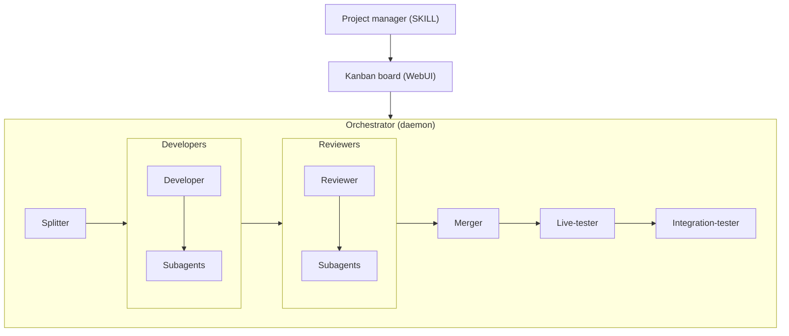

# se-llm-team

One skill turns your coding-agent session into the Project manager. A non-LLM deterministic orchestrator daemon runs a kanban pipeline of headless coding agents.

- [Splitter](agents/splitter.md): splits moderate and complex tasks into parallel subtasks before development starts.
- [Developer](agents/developer.md): implements the Specs in an isolated worktree. It can delegate research or parallel work to subagents.
- [Reviewer](agents/reviewer.md): reviews the diff against the Specs, fixes small mistakes, and can send the task back to the developer. It can use subagents.
- [Merger](agents/merger.md): resolves rebase conflicts only. The orchestrator merges clean branches itself.
- [Live-tester](agents/live-tester.md): runs the merged commit like a user and reports findings.
- [Integration-tester](agents/integration-tester.md): runs the full project test suite on the merged base branch and reports defects and coverage gaps.
- [Doctor](agents/doctor.md): after every successful run, writes what it learned into that role's notes file so future runs start faster. There is one for the developer, reviewer, merger, live-tester, and integration-tester.



## Setup

### pi

Install the package from git:

```sh
pi install git:github.com/sphamba/se-llm-team
```

The https URL form works too: `pi install https://github.com/sphamba/se-llm-team`. The package provides the kanban and orchestrator tools, the `se-llm-team` skill, and the agent prompts.

### Claude Code

Add the repo as a plugin marketplace and install the plugin:

```sh
claude plugin marketplace add sphamba/se-llm-team
claude plugin install se-llm-team@se-llm-team
```

The plugin provides the skill, the kanban and orchestrator MCP server, and the hooks that deliver board reports. A manual `.mcp.json` without the plugin is the development path. See [MCP server](#mcp-server-claude-code).

### Requirements

Node >= 24 is required for both hosts. The sources are `.ts` files run directly through node type stripping. There is no build step.

For pi development, symlink the repo to `~/.pi/agent/extensions/se-llm-team/`. pi loads `index.ts` from that path. Add the skill with a second symlink:

```sh
ln -s /path/to/se-llm-team/skills/se-llm-team ~/.pi/agent/skills/se-llm-team
```

## Using it

Start pi in a project and run the `se-llm-team` skill. In Claude Code, run `/se-llm-team:se-llm-team`. The skill makes the session the Project manager. The kanban tools drive the board, and `orchestrator_start` runs the daemon. The orchestrator sends board reports to the chat. The PM workflow is in [`skills/se-llm-team/SKILL.md`](skills/se-llm-team/SKILL.md). See [Documentation](#documentation).

## MCP server (Claude Code)

Claude Code sessions get the same kanban and orchestrator tools through a zero-dependency stdio MCP server. Node >= 24 runs the `.ts` entry directly, so there is no install step. The plugin starts the server through `.mcp.json`. Without the plugin, register it manually:

```sh
node /path/to/se-llm-team/src/mcp.ts
```

For a manual `.mcp.json` in the project:

```json
{
  "mcpServers": {
    "se-llm-team": {
      "command": "node",
      "args": ["/path/to/se-llm-team/src/mcp.ts"]
    }
  }
}
```

The server resolves the project root from its cwd. Its `orchestrator_start` passes `--default-agent claude` to the daemon. Board reports do not go through the MCP server. The plugin hooks deliver them.

## Configuration

The config is optional. The global file is `~/.se-llm-team/config.json` (`XDG_CONFIG_HOME` is ignored). A `se-llm-team.json` at the project root overrides it, and nested objects merge key by key. The old `.kanban/se-llm-team.json` and `~/.pi/agent/se-llm-team.json` files are not read.

```json
{
  "agent": "pi",
  "pollMinutes": 1,
  "maxParallel": 3,
  "model": "anthropic/claude-sonnet-4-5",
  "thinking": "high",
  "roles": { "developer": { "thinking": "xhigh", "complex": { "model": "big-model" } } },
  "reviewerCap": { "trivial": 0, "simple": 1, "moderate": 2, "complex": 3 },
  "reviews": true,
  "liveTesting": true,
  "integrationTesting": true,
  "webUi": { "enabled": true, "host": "localhost", "port": 4242 }
}
```

| Key | Default | Meaning |
| --- | --- | --- |
| `agent` | `pi` | Agent backend the orchestrator spawns: `pi` or `claude`. Any other value names a custom executable. |
| `pollMinutes` | `1` | Agent liveness poll interval. |
| `logStallMinutes` | `60` | An agent whose log does not grow for this many minutes is assumed dead. The task bounces back one state. |
| `maxParallel` | `0` | Maximum tasks in a working state at once. 0 means no limit. When the cap binds, higher-priority tasks start first. |
| `provider` | unset | LLM provider for the pi backend. It requires `model` and claude ignores it. |
| `model` | unset | LLM model or pattern. |
| `thinking` | unset | Reasoning level: `off`, `minimal`, `low`, `medium`, `high`, `xhigh`, or `max`. |
| `roles.<type>.<key>` | unset | Override `provider`, `model`, or `thinking` for one agent type. Unset fields keep the global value. |
| `roles.<type>.<complexity>.<key>` | unset | Same fields for one complexity: `trivial`, `simple`, `moderate`, or `complex`. Unset fields keep the role value. |
| `reviewerCap.<complexity>` | `0`/`1`/`2`/`3` | Successful reviewer runs before a to-review task force-advances to to-merge. Defaults: trivial `0`, simple `1`, moderate `2`, complex `3`. |
| `reviews` | `true` | Run the Reviewer stage. Off: a to-review task moves straight to to-merge. |
| `liveTesting` | `true` | Run the Live-tester stage. Off: a merged to-live-test task moves straight to done. |
| `integrationTesting` | `true` | Open integration-test tasks at the merge. Off: a merge opens no new integration task. |
| `webUi.enabled` | off | Serve the web dashboard with the daemon. |
| `webUi.host` | `localhost` | Dashboard bind host. |
| `webUi.port` | `4242` | Dashboard port. |

## Documentation

| Doc | Description |
| --- | --- |
| [docs/architecture.md](docs/architecture.md) | The board, the orchestrator daemon, the board mirror, and the web dashboard. |
| [docs/agents-and-tools.md](docs/agents-and-tools.md) | The agent roles and how they run, and the PM session tools. |
| [docs/development.md](docs/development.md) | The package manager, the extension load path, and the checks. |
